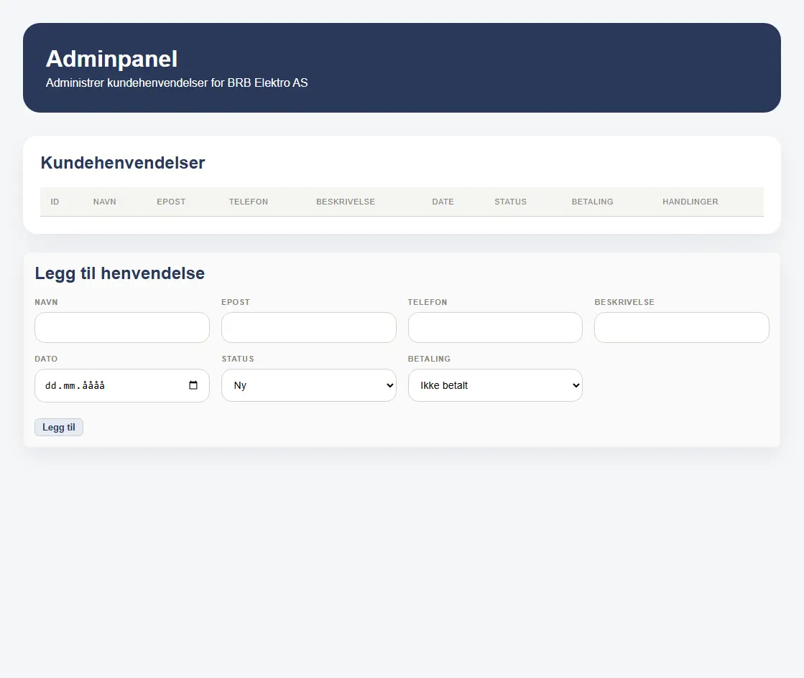

## Table of contents

*  [General info](#general-information)
*  [Live Demo](#live-demo)
*  [Technologies](#technologies)
*  [Feautures](#features)
*  [Screenshots](#screenshots)
*  [Launch](#launch)


# Overview

A responsive website built for a real client, including a contact form with backend integration and email functionality.

Live Demo: https://brbelektro.no

---

## Technologies
* HTML
* CSS
* Bootstrap
* JavaScript
* C# (.NET)
* PostgreSQL


## Features

* Responsive design (desktop & mobile)
* Navigation between multiple pages (Home, Services, Contact)
* Contact form with backend integration
* Data stored in a PostgreSQL database
* Email notifications and automatic replies on form submission
* Reusable components (navbar & footer via JS injection)


## Screenshots

### Homepage


### Services Section


### Contact Form


### Admin Dashboard



## Requirements

Make sure you have the following installed:

* .NET SDK (version 6 or newer recommended)
* PostgreSQL (running locally or accessible remotely)
* Git (optional, for cloning the repository)


## Installation

### 1. Clone the repository

```
git clone <your-repo-url>
cd BRB-Elektro-AS/BRBelektro
```

### 2. Set environment variables

This project uses environment variables to store sensitive data. They are not included in the repository for security reasons. 

Required environment variables: 

```bash 
SMTP_USER= your SMTP username
SMTP_PASSWORD= your_email_password
SMTP_FROM_EMAIL= the adress the email will be sent from
COMPANY_Mail= where the notification should be sent
SMTP_HOST= e.g mailcluster.loopia.se
SMTP_PORT= e.g 587
```
These variables are used for SMTP authentication when sending emails. Each developer must set this on their own machine.

#### 2.1 How to set up environment variables on Windows

1. Search for Environment Variables
2. Click Edit the system environment variables
3. Under User variables click New
4. Add
- Name: SMTP_USER, Value: your SMPT username (e.g mail@mail.com)
- Name: SMTP_PASSWORD, Value: your SMTP password
- Name: SMTP_FROM_EMAIL, Value: the From address (your email address)
- Name: COMAPANY_MAIL, Value: where the notification should be sent (your email address)
Optional if not hardcoded: SMTP_HOST, SMTP_PORT
5. Restart the application after setting the environment variables.

#### 2.2 Quick Test with temporary variables

```bash
set SMTP_USER=your@email.com
set SMTP_PASSWORD=your_email_password
set SMTP_FROM_EMAIL=your@email.com
set COMPANY_EMAIL=your@email.com
dotnet run
```

### 3. Configure the database

This project uses [.NET User Secrets](https://learn.microsoft.com/en-us/aspnet/core/security/app-secrets) to manage the database connection string locally. It is not committed to the repository.

Before running the project for the first time, navigate to the project folder and run:

```bash
cd BRBelektro
dotnet user-secrets init
dotnet user-secrets set "ConnectionStrings:DefaultConnection" "Host=localhost;Port=5400;Database=brbelektro;Username=postgres;Password=YOUR_PASSWORD"
```

Replace `YOUR_PASSWORD` with your local PostgreSQL password.

Make sure:

* [PostgreSQL](https://www.postgresql.org/download/) running locally or remotely
* Credentials are correct

Install the EF CLI tool globally:
```bash
dotnet tool install --global dotnet-ef --version 9.*
```


### Install dependencies

```
dotnet restore
```

### Apply database migrations
This will create the database and all tables automatically:

```bash
dotnet ef database update
```

You should now see the database appear in pgAdmin or your preferred PostgreSQL client.

## Running the application

Start the backend server:

```
dotnet run
```

You should see output like:

```
Now listening on: http://localhost:5212
```

## Access the app

Open your browser:

```
http://localhost:5212
```

## What we learned

* Connecting frontend forms to backend API
* Implementing email functionality using SMTP
* Structuring a full-stack project
* Building responsive layouts with CSS
* Creating reusable components using JS injection

## Future Improvements

* Implement authentication
* Improve frontend structure (e.g., framework integration)

---

## License

This project is proprietary and was developed for BRB Elektro AS.  
All rights reserved. Unauthorized use, copying, or distribution of this code is not permitted.

