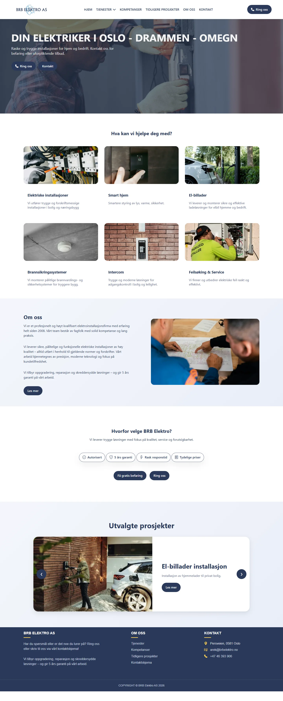
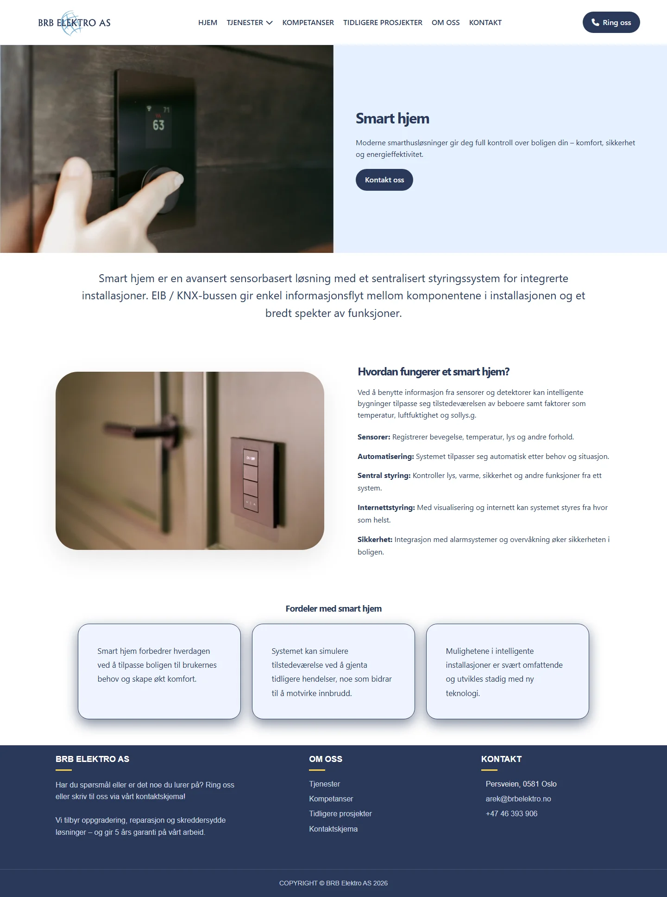
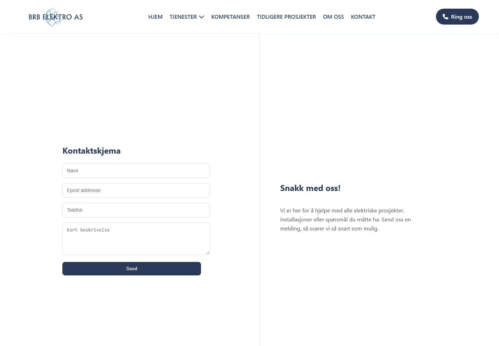

# BRB Elektro AS

A responsive website for BRB Elektro AS, an electrical contractor in Oslo, built for a real client. Customers can browse the company's services and send an inquiry through a contact form. Inquiries are saved in a PostgreSQL database, emailed to the company, and managed in an admin dashboard protected by Google Sign-In.

## Contents

* [Features](#features)
* [Technologies](#technologies)
* [Screenshots](#screenshots)
* [Project structure](#project-structure)
* [Getting started](#getting-started)
* [Configuration](#configuration)
* [API](#api)
* [Team](#team)
* [What we learned](#what-we-learned)
* [Future improvements](#future-improvements)
* [License](#license)

## Features

* Responsive multi-page site: home, eight service pages, competences, projects, about and contact
* Contact form that saves the inquiry to PostgreSQL, notifies the company by email and sends the customer an automatic reply
* Admin dashboard to view, add, edit and delete inquiries
* Admin login with Google Sign-In; the backend validates the Google token and only lets in an allowlist of accounts
* Input validation and rate limiting on the public contact endpoint
* Shared navbar and footer loaded into every page with JavaScript

## Technologies

* HTML, CSS and JavaScript (no frontend framework)
* C# with ASP.NET Core (.NET 10) Web API
* Entity Framework Core with PostgreSQL (Npgsql)
* MailKit for sending email over SMTP
* Google Identity Services (Sign In With Google) and JWT bearer authentication
* Font Awesome and Bootstrap Icons

## Screenshots

### Homepage


### Service page


### Contact form


### Admin dashboard


## Project structure

```
BRBelektro/
├── Controllers/     ContactController (public form) and InquiryController (admin API)
├── Data/            EF Core database context
├── Migrations/      EF Core migrations
├── Models/          Inquiry entity and ContactRequest
├── Repository/      Database access for inquiries
├── Services/        EmailService (company notification and auto-reply)
├── wwwroot/         Static frontend: pages, partials, scripts, styles and images
└── Program.cs       App setup: auth, rate limiting, database and routing
```

## Getting started

### Requirements

* [.NET 10 SDK](https://dotnet.microsoft.com/download)
* [PostgreSQL](https://www.postgresql.org/download/), running locally or remotely
* The EF Core CLI tool:

```bash
dotnet tool install --global dotnet-ef
```

### 1. Clone the repository

```bash
git clone https://github.com/WiktoriaSzu/BRB-Elektro-AS.git
cd BRB-Elektro-AS/BRBelektro
```

### 2. Add your settings

Secrets are kept out of the repository with [.NET User Secrets](https://learn.microsoft.com/en-us/aspnet/core/security/app-secrets). From the `BRBelektro` folder:

```bash
dotnet user-secrets set "ConnectionStrings:DefaultConnection" "Host=localhost;Port=5432;Database=brbelektro;Username=postgres;Password=YOUR_PASSWORD"
dotnet user-secrets set "Admin:AllowedEmails:0" "you@gmail.com"
```

Email settings are optional. Without them the contact form still saves inquiries, and the email error is written to the log. See [Configuration](#configuration) for the full list.

### 3. Create the database

```bash
dotnet ef database update
```

### 4. Run the app

```bash
dotnet run
```

Open http://localhost:5212 for the website and http://localhost:5212/login.html for the admin dashboard.

## Configuration

Every setting can be given as a user secret or an environment variable. In environment variables, replace `:` with a double underscore, for example `Admin__AllowedEmails__0` or `ConnectionStrings__DefaultConnection`.

| Setting | Required | Description |
| --- | --- | --- |
| `ConnectionStrings:DefaultConnection` | Yes | PostgreSQL connection string |
| `Admin:AllowedEmails` | For admin access | Google accounts allowed into the admin dashboard (a list: `Admin:AllowedEmails:0`, `Admin:AllowedEmails:1`, …) |
| `SMTP_USER` | For email | SMTP username |
| `SMTP_PASSWORD` | For email | SMTP password |
| `SMTP_FROM_EMAIL` | For email | Address the emails are sent from |
| `COMPANY_EMAIL` | For email | Address that receives new inquiries |
| `SMTP_HOST` | No | SMTP server, defaults to `mailcluster.loopia.se` |
| `SMTP_PORT` | No | SMTP port, defaults to `587` |
| `Authentication:Google:ClientId` | No | Google OAuth client ID, set in `appsettings.json` |

### Using your own Google client ID

To run the admin login under your own Google account, create an OAuth client ID (type "Web application") in the [Google Cloud Console](https://console.cloud.google.com/apis/credentials) and add `http://localhost:5212` as an authorized JavaScript origin. Put the client ID in `appsettings.json` and in `wwwroot/login.html`.

## API

| Method | Route | Access | Description |
| --- | --- | --- | --- |
| `POST` | `/api/contact` | Public, rate limited | Submit the contact form |
| `GET` | `/api/inquiry` | Admin | List all inquiries |
| `GET` | `/api/inquiry/{id}` | Admin | Get one inquiry |
| `POST` | `/api/inquiry` | Admin | Add an inquiry |
| `PUT` | `/api/inquiry/{id}` | Admin | Update an inquiry |
| `DELETE` | `/api/inquiry/{id}` | Admin | Delete an inquiry |

Admin routes need a Google ID token in the `Authorization: Bearer` header from an account listed in `Admin:AllowedEmails`.

## Team

* **Wiktoria Szulik** ([@WiktoriaSzu](https://github.com/WiktoriaSzu)): backend API, PostgreSQL database and EF Core, admin dashboard features, Google Sign-In
* **Malwina Czajka** ([@Mal-wina](https://github.com/Mal-wina)): page design and responsive layout, service pages, email integration, admin dashboard styling

## What we learned

* Connecting frontend forms to a backend API
* Modelling data with Entity Framework Core and migrations
* Sending email over SMTP with MailKit
* Securing an admin area with Google Sign-In and token validation
* Keeping secrets out of the repository with user secrets and environment variables
* Building responsive layouts with CSS
* Reusing components with JavaScript injection

## Future improvements

* Automated tests for the API
* A logout button and session handling in the admin dashboard
* Moving the frontend to a component framework

## License

This project is proprietary and was developed for BRB Elektro AS.
All rights reserved. Unauthorized use, copying, or distribution of this code is not permitted.
